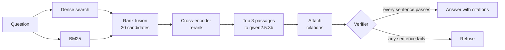

<div align="center">

# EvidenceRAG

### Ask your documents. Get proof, or get told there isn't any.

A local RAG app that shows the passage behind every sentence, checks each sentence before showing it, and refuses when the evidence isn't there. Built as an educational project.

[](https://github.com/Sahil-u07/evidencerag/actions/workflows/ci.yml)


</div>

<table>
<tr>
<td width="50%"></td>
<td width="50%"></td>
</tr>
<tr>
<td align="center"><b>The document answers it.</b> Each sentence links to its passage.</td>
<td align="center"><b>The document doesn't.</b> So the app refuses.</td>
</tr>
</table>

## What you'll learn from it

Hybrid search (BM25 plus embeddings), rank fusion, cross-encoder reranking, checking a model's answer with NLI, and how to evaluate a search system honestly with a held-out test set and confidence intervals. Each step is explained with diagrams and formulas in **[How it works](docs/how-it-works.md)**.

## Quick start

You need Python 3.12, Node 22.12+ and [Ollama](https://ollama.com/download).

```bash
ollama pull qwen2.5:3b
```

```bash
cd backend
python -m venv .venv
source .venv/bin/activate          # PowerShell: .\.venv\Scripts\Activate.ps1
pip install -r requirements.txt
uvicorn app.main:app
```

```bash
cd frontend
npm ci
npm run dev
```

Open `http://localhost:5173`, drop in a PDF, TXT or Markdown file, and ask. Settings are in [`.env.example`](.env.example).

## How it works



The model's answer is treated as a draft. Each sentence must cite a passage, every number in it must appear in that passage, and an NLI model must agree the passage supports it. One failed sentence and the whole draft is thrown out. Everything runs on your machine, with no API key.

## Results

Tuned on 40 `dev` questions, then scored once on 40 held-out `test` questions over six RFCs:

| Held-out test set | Original | Final |
|---|---:|---:|
| Retrieval nDCG@5 | 0.425 | **0.468** |
| Verifier accuracy | 0.633 | **0.867** |
| False claims accepted | 5 of 15 | **2 of 15** |
| Answers verified | not measured | **37.5%** |
| Answers refused | not measured | **62.5%** |

The retrieval gain is inside the noise, and the verifier gain is real but from only 30 cases. The biggest single improvement came from a bug fix: PDF chunk numbering restarted on every page, so most of each PDF was unreachable. Eight tuning ideas were tried and none passed the bar. Full tables, confidence intervals and the failed experiments are in [How it works](docs/how-it-works.md#results).

## Limits

- Verified doesn't mean correct: one answer passed saying ES256 "MUST" be implemented when the passage says "RECOMMENDED".
- It refuses most questions that are worded differently from the document.
- The checking model is small and refuses some correct answers.
- 40 test questions on one CPU-only laptop, so treat the numbers as indicative.

## More

- [Blog post on Medium](https://medium.com/@sahillenka44/my-rag-app-scored-0-973-then-i-gave-it-a-real-test-f787853e6354): the story of the project, from a 0.973 score that meant little to the honest results
- [How it works](docs/how-it-works.md): diagrams, formulas, the API and the full results
- [Benchmark design](docs/benchmark-design.md)
- Tests: `cd backend && python -m pytest -q`, and `cd frontend && npm test`

## License

Code is [MIT](LICENSE). `qwen2.5:3b` is under the Qwen Research License. The RFC texts are redistributed under the IETF Trust's terms ([`SOURCES.md`](data/evaluation/v2/corpus/SOURCES.md)).
