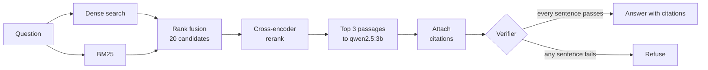

<div align="center">

# EvidenceRAG

### Ask your documents. Get proof, or get told there isn't any.

A document Q&A app that runs entirely on your machine, shows the passage behind every sentence, and would rather refuse than make something up.

[](https://github.com/Sahil-u07/evidencerag/actions/workflows/ci.yml)


[Quick start](#quick-start) · [How it works](#how-it-works) · [Scorecard](#the-scorecard) · [Known limits](#what-it-gets-wrong) · [API](#api)

</div>

<table>
<tr>
<td width="50%"></td>
<td width="50%"></td>
</tr>
<tr>
<td align="center"><b>The document answers it.</b> Click the citation and the passage lights up.</td>
<td align="center"><b>The document doesn't.</b> So the app says so.</td>
</tr>
</table>

<sub>Both from a real run: backend, frontend and <code>qwen2.5:3b</code> through Ollama, with RFC 7519 (JWT) uploaded through the UI.</sub>

## The idea

Most RAG demos make one model call and hope for the best. EvidenceRAG treats the model's answer as a draft and refuses to trust it until every sentence survives a check against the passages it cites. One failure and the whole draft is thrown out.

| | |
|---|---|
| **Local** | Generation, search and verification all run on your machine. No external LLM API. |
| **Shows its work** | Every sentence links to the exact passage behind it. |
| **Drafts look like drafts** | Streaming text is labelled "Draft, not checked yet" until the check finishes. |
| **Measured honestly** | Tuned on one set of questions, then scored once on a held-out set. Failed experiments stay in the repo. |

The strictness has a price: the app refuses a lot, and a passed check still doesn't prove an answer is right. [The numbers below](#the-scorecard) don't hide either.

## Quick start

You need Python 3.12, Node 22.12 or newer, and [Ollama](https://ollama.com/download).

**1. Get the model**

```bash
ollama pull qwen2.5:3b
```

**2. Start the backend**

```bash
cd backend
python -m venv .venv
source .venv/bin/activate          # PowerShell: .\.venv\Scripts\Activate.ps1
pip install -r requirements.txt
uvicorn app.main:app
```

The first start downloads three small Hugging Face models. The API docs are at `http://127.0.0.1:8000/docs`.

**3. Start the frontend**

```bash
cd frontend
npm ci
npm run dev
```

Open `http://localhost:5173`, drop in a PDF, TXT or Markdown file, and ask something.

<details>
<summary><b>Optional settings</b></summary>

<br>

The defaults work without a `.env`. To change them, copy the example to the repository root:

```bash
cp .env.example .env      # PowerShell: Copy-Item .env.example .env
```

| Variable | Default | Meaning |
|---|---|---|
| `OLLAMA_URL` | `http://127.0.0.1:11434` | Where Ollama listens |
| `OLLAMA_MODEL` | `qwen2.5:3b` | Generation model |
| `MAX_UPLOAD_SIZE_MB` | `10` | Upload size limit |
| `INDEX_STORAGE_DIR` | `data/index` | Index location, relative to the repository root |
| `UPLOAD_DIR` | `data/uploads` | Upload location, relative to the repository root |

The API only accepts browser requests from port 5173. To point the frontend at a different API, set `VITE_API_BASE`.

</details>

## How it works



Documents are split into 50-word chunks with 10 words of overlap, and saved with their embeddings. SHA-256 fingerprints mean an unchanged document is never embedded twice.

### The verifier

Each sentence has to get through this before the answer is shown:

| Check | What it does |
|---|---|
| **Citation rule** | Every factual sentence needs a citation. One uncited sentence fails the whole answer. |
| **Number guard** | Every number in the sentence must appear in the cited passage. `7` doesn't pass against "four". |
| **Exact quote rule** | At least five content words quoted word for word pass without further checks, if negation agrees. |
| **NLI** | `nli-MiniLM2-L6-H768` must say the passage entails the sentence, with at least 0.70 confidence. |
| **Lexical fallback** | If NLI isn't confident, 75% content-word overlap can pass. It can never overrule a contradiction. |
| **Negation guard** | "does not" and "only if" must match the closest sentence in the passage, for the quote rule and the fallback. |

### The stack

| Layer | Using |
|---|---|
| Frontend | React 19, TypeScript, Vite, plain CSS, Server-Sent Events |
| Backend | Python, FastAPI, Pydantic |
| Retrieval | `all-MiniLM-L6-v2`, BM25, reciprocal rank fusion, `ms-marco-MiniLM-L-6-v2` |
| Generation | Ollama, `qwen2.5:3b`, top 3 passages, temperature 0 |
| Verification | `nli-MiniLM2-L6-H768`, plus the checks above |
| Storage | NumPy embedding matrix, JSON metadata, SHA-256 fingerprints |

## The scorecard

This project used to report nDCG@5 of 0.973. That test had 33 chunks and was too easy to mean much, so I built a harder one: six real RFCs, 4,706 chunks, 80 questions and 60 verifier cases. All tuning happened on the `dev` half. The `test` half ran once, at the end.

| Held-out `test` set | Original code | Final |
|---|---:|---:|
| Retrieval nDCG@5 | 0.425 | **0.468** |
| Verifier accuracy | 0.633 | **0.867** |
| False claims accepted | 5 of 15 | **2 of 15** |
| True claims refused | 6 of 15 | **2 of 15** |
| Answers verified | not measured | **37.5%** |
| Answers refused | not measured | **62.5%** |

**How to read this:** the retrieval ranges overlap heavily, so that gain is inconclusive. The verifier's gain is the clearest result, but it comes from only 30 cases, so it's suggestive and not settled. The refusal rate is high, and most of it comes from questions worded differently from the document.

Every number in this README comes from a JSON report in [`data/evaluation/reports/`](data/evaluation/reports), and you can re-run them.

<details>
<summary><b>Full retrieval results</b></summary>

<br>

Reports: `shipped-retrieval-test.json` and `final-retrieval-test.json`. 40 questions, 95% bootstrap intervals in brackets. Reranked Hybrid:

| | Hit@1 | Hit@3 | Hit@5 | MRR | nDCG@5 | Median latency |
|---|---|---|---|---|---|---:|
| Original | 0.350 (0.200 to 0.500) | 0.500 (0.350 to 0.650) | 0.550 (0.400 to 0.700) | 0.438 (0.300 to 0.575) | 0.425 (0.297 to 0.558) | 931 ms |
| Final | 0.350 (0.200 to 0.500) | 0.500 (0.350 to 0.650) | 0.600 (0.450 to 0.750) | 0.449 (0.316 to 0.586) | 0.468 (0.338 to 0.599) | 483 ms |

The two latency figures were taken at different times on the same laptop, so don't read them as a speed-up.

All four systems, final code:

| System | Hit@5 | nDCG@5 | Median latency |
|---|---|---|---:|
| Dense | 0.500 (0.350 to 0.650) | 0.406 (0.274 to 0.542) | 12 ms |
| BM25 | 0.475 (0.325 to 0.625) | 0.390 (0.255 to 0.526) | 13 ms |
| Hybrid (RRF) | 0.500 (0.350 to 0.650) | 0.416 (0.275 to 0.558) | 36 ms |
| Reranked Hybrid | 0.600 (0.450 to 0.750) | 0.468 (0.338 to 0.599) | 483 ms |

By question type, Reranked Hybrid, final code:

| Type | Questions | Hit@3 | Hit@5 | MRR | nDCG@5 |
|---|---:|---|---|---|---|
| Identifier | 12 | 0.750 (0.500 to 1.000) | 0.833 (0.583 to 1.000) | 0.604 (0.396 to 0.812) | 0.662 (0.448 to 0.846) |
| Multi-fact | 8 | 0.750 (0.375 to 1.000) | 0.875 (0.625 to 1.000) | 0.781 (0.500 to 1.000) | 0.709 (0.444 to 0.936) |
| Paraphrase | 20 | 0.250 (0.100 to 0.450) | 0.350 (0.150 to 0.550) | 0.223 (0.075 to 0.388) | 0.254 (0.100 to 0.426) |

Exact terms are found well. Reworded questions aren't, and that's the biggest weakness in the system.

The original 20-question set stays as a regression check (`final-retrieval-v1.json`). Reranked Hybrid scores Recall@1/3/5 of 0.650, 0.975 and 0.975, MRR 1.000 and nDCG@5 0.973, the same as before. Recall@1 can't go above 0.650 on that set, so it can't show an improvement.

</details>

<details>
<summary><b>Full verifier results</b></summary>

<br>

Reports: `shipped-verification-test.json` and `final-verification-test.json`. 30 cases, 15 supported and 15 unsupported.

| | Accuracy | False accept | False reject |
|---|---|---|---|
| Original | 0.633 (0.467 to 0.800) | 5 of 15, 0.333 (0.133 to 0.600) | 6 of 15, 0.400 (0.133 to 0.667) |
| Final | 0.867 (0.733 to 0.967) | 2 of 15, 0.133 (0.000 to 0.333) | 2 of 15, 0.133 (0.000 to 0.333) |

The original report predates the counts and intervals, so those were computed from its per-case results with the same bootstrap function. On dev (`final-verification-dev.json`), the final verifier accepted 0 of 15 unsupported cases and refused 4 of 15 supported ones. Test accepted 2, so dev was optimistic.

</details>

<details>
<summary><b>Full answer results</b></summary>

<br>

Reports: `final-answers-dev.json` and `final-answers-test.json`, 40 questions each, through the whole pipeline with `qwen2.5:3b`.

| | Dev | Test |
|---|---|---|
| Verified | 0.450 (0.300 to 0.600) | 0.375 (0.225 to 0.525) |
| Abstained | 0.550 (0.400 to 0.700) | 0.625 (0.475 to 0.775) |
| Useful | 0.375 (0.225 to 0.525) | 0.225 (0.100 to 0.350) |
| Verified, given a relevant chunk in the top 3 | 0.630 (0.444 to 0.815) | 0.550 (0.350 to 0.750) |
| Generation time, median | 4,643 ms | 5,854 ms |
| Generation time, 95th percentile | 7,708 ms | 8,515 ms |

"Useful" means verified, with at least half of the labelled evidence's content words in the answer. It's a rough word-overlap proxy and doesn't check correctness, so a verified wrong answer can count as useful.

By question type on test: identifier 0.583 verified and 0.417 useful, multi-fact 0.500 and 0.375, paraphrase 0.200 and 0.050.

</details>

### The graveyard

Ideas that looked promising, measured on dev. A retrieval change had to raise nDCG@5 by at least 0.01 and keep median retrieval under 3 seconds. Almost nothing survived.

| Trial | Dev nDCG@5 | Median | Verdict |
|---|---:|---:|---|
| **Current setup** | **0.621** | 390 ms | Kept |
| BM25 with stopwords and stemming | 0.630 | 459 ms | Out: +0.009, just under the bar |
| BGE embeddings with query prefix | 0.617 | 414 ms | Out |
| 40 reranker candidates | 0.608 | 2,199 ms | Out |
| 10 reranker candidates | 0.598 | 551 ms | Out |
| Bigger L-12 reranker | 0.592 | 799 ms | Out |
| BGE embeddings | 0.574 | 557 ms | Out |
| Sentence chunks, 200 words | 0.572 | 3,076 ms | Out, and too slow |
| Sentence chunks, 120 words | 0.570 | 1,827 ms | Out |

The biggest single retrieval gain was a bug fix, not tuning. PDF chunk numbering restarted on every page, so fusion merged chunks that shared an ID and lost most of each PDF. On RFC 9293, 843 chunks had just 16 unique IDs. Fixing that took dev nDCG@5 from 0.568 to 0.621.

**Choosing the model**, 40 dev questions:

| Model | Verified | Refused | Useful | Median generation |
|---|---:|---:|---:|---:|
| `llama3.2:1b` | 0.275 | 0.725 | 0.200 | 4,736 ms |
| `llama3.2:3b` | 0.325 | 0.675 | 0.275 | 6,418 ms |
| **`qwen2.5:3b`** | **0.450** | **0.550** | **0.375** | 5,766 ms |

The intervals overlap, so the ranking isn't settled, but `qwen2.5:3b` had the best numbers.

**A smarter verifier, reverted.** Checking claims against a focused window of the passage and choosing citations by entailment got more answers verified, 0.450 to 0.525. Useful answers only went from 0.375 to 0.400, short of the 0.05 bar, and reading the answers by hand showed the window had let two wrong ones through. The reports are kept in the repo (`qwen25-3b-fixed-answers-dev.json`, `qwen25-3b-citeonly-answers-dev.json`).

## What it gets wrong

Worth knowing before you trust it:

- **Verified doesn't mean correct.** One dev answer passed saying ES256 MUST be implemented, when the passage says RECOMMENDED.
- **It refuses a lot.** 22 of 40 dev questions and 25 of 40 test questions, mostly reworded ones where retrieval misses the passage.
- **The NLI model is small.** It reads whole 50-word chunks and refuses some correct answers: 4 of 15 supported dev cases.
- **Summary sentences hurt.** An uncited "In summary..." fails the whole answer, even if the rest is sound.
- **The benchmark isn't independently reviewed.** The split was frozen before the baseline runs, but nobody outside the project has checked the labels. A few dev and test questions also share neighbouring text, for example v2-019 and v2-003.
- **Small samples.** 40 test questions gives wide intervals, so differences of a few points are inconclusive.
- **One laptop.** All timings come from one CPU-only machine. The answer reports ran with Ollama at `localhost`, which cost about 2 extra seconds per request there, so their generation times read about 2 seconds high. The default is now `127.0.0.1`.
- **Browser tests aren't in the repo.** I checked the UI in Chrome with scripts I didn't commit. CI runs the unit tests, frontend lint and build.

## API

| Method | Endpoint | Description |
|---|---|---|
| `GET` | `/health` | Readiness and model information |
| `POST` | `/search` | Retrieval only, no generation |
| `POST` | `/ask` | Full pipeline, one JSON response |
| `POST` | `/query/stream` | Full pipeline as Server-Sent Events |
| `POST` | `/documents/upload` | Upload a PDF, TXT or MD file |
| `GET` | `/documents` | List uploaded documents |
| `DELETE` | `/documents/{filename}` | Remove a document and rebuild the index |

`/search`, `/ask` and `/query/stream` take `{"query": "...", "top_k": 5}`, with `top_k` from 1 to 20.

<details>
<summary><b>Response details</b></summary>

<br>

**`GET /health`** returns `status`, `ready`, `generator`, `model`, `generator_available` (Ollama answers and has the model) and `max_upload_mb`.

**`POST /search`** returns `query` and `results`. Each passage has `evidence_id`, `source`, `chunk_id`, `page` (null for text files), `score` and `text`. The score is a raw cross-encoder score, not a probability.

**`POST /ask`** returns `query`, `answer`, `evidence`, `verification` (`supported`, `cited_evidence`, `unsupported_claims`, `reason`) and `metrics`.

**`POST /query/stream`** sends these events in order:

| Event | Data |
|---|---|
| `stage` | `{"i": 1, "ms": ...}` after retrieval, `i` 2 after generation, `i` 3 after verification |
| `sources` | `{"items": [...]}`, the passages |
| `token` | `{"t": "..."}`, a piece of the unchecked draft |
| `verification` | `supported`, `cited_evidence`, `unsupported_claims`, `reason` |
| `final` | `{"answer": "...", "supported": bool, "latency_ms": ...}`, the answer to show |
| `done` | `{"latency_ms": ..., "supported": bool}` |
| `error` | `{"message": "..."}`, sent instead of the events that would follow |

Uploads return 400 for an unsupported or unreadable file or one with no extractable text, and 413 for a file over the limit.

</details>

## Run the tests

```bash
cd backend && python -m pytest -q                  # 256 tests
```

```bash
cd frontend && npm test && npm run lint && npm run build   # 40 tests, lint, build
```

<details>
<summary><b>Re-run the benchmarks</b></summary>

<br>

From `backend/`, with the virtual environment active:

```bash
python -m scripts.benchmark retrieval --set v1 --label mine
python -m scripts.benchmark retrieval --set dev --label mine
python -m scripts.benchmark verification --set dev --label mine
python -m scripts.benchmark answers --set dev --label mine      # needs Ollama
```

Reports go to `data/evaluation/reports/<label>-<kind>-<set>.json`. The test split needs `--final`, takes no tuning options, and should be run once. Use a new `--label`, because running with `final` overwrites the published reports and raises `run_count`.

`retrieval` also takes `--chunking`, `--chunk-size`, `--chunk-overlap`, `--candidates`, `--embedding-model` and `--reranker-model`. `answers` also takes `--model`. The design is in [`docs/benchmark-design.md`](docs/benchmark-design.md).

</details>

<details>
<summary><b>Repository layout</b></summary>

<br>

```text
evidencerag/
├── backend/
│   ├── app/
│   │   ├── core/          # settings, retrieval defaults, sentence splitting
│   │   ├── evaluation/    # metrics, evidence labels, bootstrap intervals
│   │   ├── generation/    # prompt, Ollama client, streaming, pipeline, verifier
│   │   ├── ingestion/     # loading and chunking
│   │   ├── reranking/     # cross-encoder and the reranked hybrid retriever
│   │   ├── retrieval/     # dense, BM25, fusion, persistent store
│   │   ├── indexing.py    # incremental index build
│   │   ├── main.py        # FastAPI app
│   │   └── schemas.py
│   ├── scripts/benchmark.py
│   └── tests/
├── frontend/src/          # React, TypeScript: components, hooks, lib
├── data/
│   ├── evaluation/
│   │   ├── corpus/        # v1 corpus (4 Markdown files)
│   │   ├── golden_set.json
│   │   ├── v2/            # six RFCs, questions, verifier cases, SOURCES.md
│   │   └── reports/       # every benchmark report cited here
│   ├── index/             # generated, ignored by git
│   └── uploads/           # your documents, ignored by git
├── docs/benchmark-design.md
├── screenshots/
└── .github/workflows/ci.yml
```

</details>

## License

The code is [MIT](LICENSE). Two things in this project have their own terms: `qwen2.5:3b` is under the Qwen Research License, so check it for your use, and the RFC texts are redistributed under the IETF Trust's provisions ([`SOURCES.md`](data/evaluation/v2/corpus/SOURCES.md)).

<div align="center">

Built by [Sahil](https://github.com/Sahil-u07)

</div>
