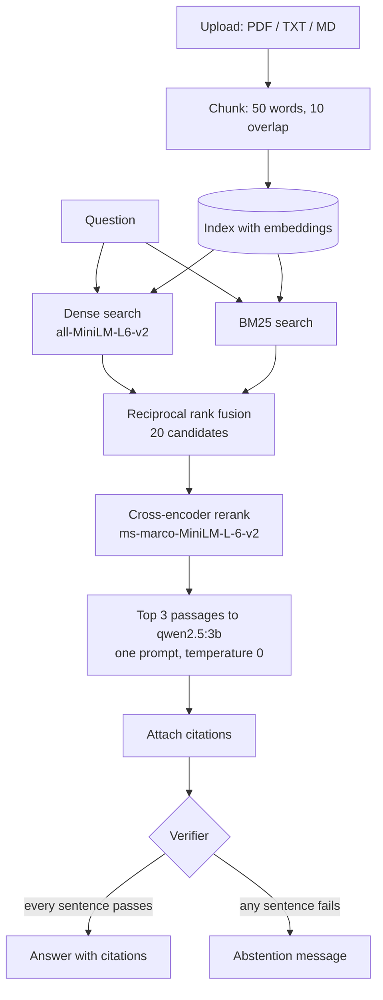

# EvidenceRAG

EvidenceRAG answers questions from documents you upload (PDF, TXT, Markdown). It retrieves passages with dense search and BM25, reranks them with a cross-encoder, and gives the top three to a local Ollama model (`qwen2.5:3b`). It then checks every sentence of the draft against the passages it cites. If any sentence fails the check, the app shows an abstention message instead of the draft.

Everything runs on your machine. There is no external LLM API.

The check makes the app abstain often, and a passed check does not prove an answer is correct. The numbers are in [Evaluation](#evaluation) and the details in [Known limits](#known-limits).

## Screenshots

Both screenshots come from a real run: the backend, the frontend and `qwen2.5:3b` through Ollama, with `data/evaluation/v2/corpus/rfc7519.pdf` (RFC 7519, JWT) uploaded through the UI. In the first, the answer cites passage 1 and the cited passage is highlighted after clicking the citation. In the second, the question is about TCP, which this document does not cover, so the app abstains.


## How it works



1. **Ingest and chunk.** PDF, TXT and Markdown are split into 50-word chunks with 10 words of overlap. PDF chunks keep their page number. Chunk ids for PDFs include the page, so they are unique across pages.
2. **Index.** Chunks and embeddings are saved to disk. SHA-256 fingerprints decide which documents are new, changed or deleted, so unchanged documents are not embedded again.
3. **Retrieve.** Dense search (`all-MiniLM-L6-v2`) and BM25 each return a ranked list. Reciprocal rank fusion merges them into 20 candidates, and `cross-encoder/ms-marco-MiniLM-L-6-v2` reranks those. The API returns the top `top_k` passages (default 5).
4. **Generate.** There is one prompt and one answer path. The model sees only the top 3 passages, at temperature 0, with a limit of 80 generated tokens. The prompt tells it to use only the evidence and not to write citations. If the model hits the token limit, an unfinished last sentence is dropped.
5. **Cite.** The app adds `[Evidence N]` to each sentence that has none, using the passage that shares the most words with it (at least half of the sentence's words of three letters or more). Only the 3 passages the model saw can be cited.
6. **Verify.** See below.

### The verifier

The verifier checks each sentence of the answer against the passages it cites. The answer is accepted only if every sentence passes.

- **Citation rule.** Every factual sentence needs a citation. An uncited sentence makes the whole answer abstain. Short replies such as "Yes." with no content words, no number and no citation are skipped.
- **NLI.** `cross-encoder/nli-MiniLM2-L6-H768` must label the cited passage as entailing the sentence, with confidence of at least 0.70.
- **Exact quote rule.** A sentence of at least five content words that appears word for word in the cited passage is accepted without NLI, if it agrees with the passage on negation.
- **Lexical fallback.** If NLI is not confident, a sentence with at least five content words and at least 75% of them in the passage is accepted. This never overrides an NLI contradiction, and it also needs the negation check.
- **Number guard.** Every number in the sentence, including spelled-out ones from zero to twelve (except "one"), must appear in the cited passage. Otherwise that citation does not support the sentence.
- **Negation guard.** For the quote rule and the lexical fallback, the sentence and the closest sentence of the passage must agree on whether they contain a negation.

## Features

- Hybrid retrieval (dense plus BM25) with cross-encoder reranking.
- A persistent, incremental index.
- Server-Sent Events stream with retrieval, tokens and the verification result.
- A web UI with citation links that highlight the cited passage, an evidence panel, a visible "draft, not checked yet" label while streaming, light and dark themes, and a demo mode with made-up data that never shows the Verified label.
- PDF, TXT and Markdown upload, limited to 10 MB by default.

## Quick start

You need Python 3.12 (the version used in development and CI), Node 22.12 or newer, and [Ollama](https://ollama.com/download).

### 1. Get the model

Install Ollama, make sure it is running, then pull the default model:

```bash
ollama pull qwen2.5:3b
ollama list
```

`qwen2.5:3b` is under the Qwen Research License. See [Known limits](#known-limits).

### 2. Optional: configure

The defaults work without a `.env`. To change them, copy the example to the repository root:

```bash
cp .env.example .env      # PowerShell: Copy-Item .env.example .env
```

| Variable | Default | Meaning |
|---|---|---|
| `OLLAMA_URL` | `http://127.0.0.1:11434` | Where Ollama listens |
| `OLLAMA_MODEL` | `qwen2.5:3b` | Generation model |
| `MAX_UPLOAD_SIZE_MB` | `10` | Upload size limit |
| `INDEX_STORAGE_DIR` | `data/index` | Index location, relative to the repository root |
| `UPLOAD_DIR` | `data/uploads` | Upload location, relative to the repository root |

### 3. Start the backend

```bash
cd backend
python -m venv .venv
source .venv/bin/activate          # PowerShell: .\.venv\Scripts\Activate.ps1
pip install -r requirements.txt
uvicorn app.main:app
```

The first start downloads three small Hugging Face models (`all-MiniLM-L6-v2`, `cross-encoder/ms-marco-MiniLM-L-6-v2`, `cross-encoder/nli-MiniLM2-L6-H768`), so it needs internet once. `pip install` pulls in PyTorch. On a machine without a GPU, install the CPU build first to avoid the large CUDA download: `pip install torch --index-url https://download.pytorch.org/whl/cpu`.

The API is at `http://127.0.0.1:8000` and its interactive docs are at `/docs`.

### 4. Start the frontend

```bash
cd frontend
npm ci
npm run dev
```

Open `http://localhost:5173`, upload a document and ask a question. The API only accepts browser requests from port 5173. To point the frontend at a different API, set `VITE_API_BASE`.

## API

| Method | Endpoint | Description |
|---|---|---|
| `GET` | `/health` | Readiness and model information |
| `POST` | `/search` | Retrieval only, no generation |
| `POST` | `/ask` | Full pipeline, one JSON response |
| `POST` | `/query/stream` | Full pipeline as a Server-Sent Events stream |
| `POST` | `/documents/upload` | Upload a PDF, TXT or MD file |
| `GET` | `/documents` | List uploaded documents |
| `DELETE` | `/documents/{filename}` | Remove a document and rebuild the index |

`/search`, `/ask` and `/query/stream` take `{"query": "...", "top_k": 5}`. `query` must not be empty and `top_k` is 1 to 20, default 5.

**`GET /health`** returns `status`, `ready` (the index is loaded), `generator` (always `"ollama"`), `model`, `generator_available` (Ollama is reachable and has the configured model) and `max_upload_mb`.

**`POST /search`** returns `query` and `results`, a list of passages. Each passage has `evidence_id`, `source`, `chunk_id`, `page` (null for TXT and Markdown), `score` and `text`.

**`POST /ask`** returns:

- `query` and `answer`, which is the cited answer or the abstention message.
- `evidence`, the passages, in the same shape as `/search`.
- `verification`: `supported`, `cited_evidence` (list of ids), `unsupported_claims` (list of sentences) and `reason`.
- `metrics`: `query`, `top_k`, `retrieved_evidence_count`, `cited_evidence_count`, `verification_supported` and `latency_ms`.

**`POST /query/stream`** sends these events in this order:

| Event | Data |
|---|---|
| `stage` | `{"i": 1, "ms": ...}` after retrieval, `i` 2 after generation, `i` 3 after verification |
| `sources` | `{"items": [...]}`, the passages |
| `token` | `{"t": "..."}`, one per generated piece of text |
| `verification` | `supported`, `cited_evidence`, `unsupported_claims`, `reason` |
| `final` | `{"answer": "...", "supported": bool, "latency_ms": ...}` |
| `done` | `{"latency_ms": ..., "supported": bool}` |
| `error` | `{"message": "..."}`, sent instead of the events that would follow |

The `token` events carry the unchecked draft. Only `final` holds the answer to show.

Upload errors return 400 for an unsupported or unreadable file or one with no extractable text, and 413 for a file over the limit.

## Evaluation

Every number in this section is copied from a JSON report in `data/evaluation/reports/`. The report file names are given with each table.

### What the benchmark is

- **Corpus.** Six RFCs (TCP, JWT, DNS, HTTP semantics, TLS 1.3, OAuth 2.0), two as PDF and four as text. They produce 4,706 chunks. Sources are in `data/evaluation/v2/corpus/SOURCES.md`.
- **Retrieval questions.** 80 questions in `data/evaluation/v2/questions.json`, 40 in a `dev` split and 40 in a `test` split. Each split has 20 paraphrase questions, 12 identifier questions (the question depends on an exact term) and 8 multi-fact questions. Each question carries one or two exact phrases from the documents as evidence labels. A chunk counts as relevant if it contains a phrase. Labels are text, not chunk ids, so they survive a change of chunking.
- **Verifier cases.** 60 cases in `data/evaluation/v2/verification_cases.json`, 30 dev and 30 test, half supported and half unsupported, in nine categories (verbatim, paraphrase, multi-sentence, abbreviation or decimal, negation, wrong number, wrong entity, uncited, wrong citation).
- **Answer runs.** The 80 questions go through the whole pipeline with `qwen2.5:3b`.
- **Tuning on dev only.** A retrieval change was kept only if it raised dev nDCG@5 by at least 0.01 and median retrieval stayed under 3 seconds. Bug fixes were kept regardless. The test split was run once on the final code. The test numbers for the original code were recorded before any change, and tuning used dev only.
- **Intervals.** Intervals are 95% bootstrap intervals over questions. With 40 questions they are wide. Where two intervals overlap, the data does not separate the two results, and a small difference is inconclusive.

"Shipped" means the code as it was before this work, and "final" means the code in this repository. Each report records the commit it ran on, which is the commit before the one that stores the report. The design is in `docs/benchmark-design.md`.

### v1: the original 20-question set

Reports: `shipped-retrieval-v1.json` and `final-retrieval-v1.json`. The corpus has four Markdown files with 33 chunks. With 50-word chunks, Recall@1 for Reranked Hybrid cannot exceed 0.650, and the set is easy: this system already sits at its ceiling. Shipped and final give the same numbers for all four systems.

| Retriever | Recall@1 | Recall@3 | Recall@5 | MRR | nDCG@5 |
|---|---:|---:|---:|---:|---:|
| Dense | 0.600 | 1.000 | 1.000 | 0.975 | 0.974 |
| BM25 | 0.550 | 0.875 | 0.925 | 0.925 | 0.885 |
| Hybrid (RRF) | 0.600 | 0.900 | 0.975 | 0.975 | 0.936 |
| Reranked Hybrid | 0.650 | 0.975 | 0.975 | 1.000 | 0.973 |

v1 stays as a regression check. It cannot show an improvement.

### v2 retrieval, test split

Reports: `shipped-retrieval-test.json` (original code) and `final-retrieval-test.json` (final code, run once with `--final`). 40 questions, 95% intervals in brackets. Reranked Hybrid:

| | Hit@1 | Hit@3 | Hit@5 | MRR | nDCG@5 | Median latency |
|---|---|---|---|---|---|---:|
| Shipped | 0.350 (0.200 to 0.500) | 0.500 (0.350 to 0.650) | 0.550 (0.400 to 0.700) | 0.438 (0.300 to 0.575) | 0.425 (0.297 to 0.558) | 931 ms |
| Final | 0.350 (0.200 to 0.500) | 0.500 (0.350 to 0.650) | 0.600 (0.450 to 0.750) | 0.449 (0.316 to 0.586) | 0.468 (0.338 to 0.599) | 483 ms |

nDCG@5 went from 0.425 to 0.468, and every interval overlaps. This is not a measured improvement. The two latency figures were taken on the same laptop at different times and should not be read as a speed-up.

Final code, all four systems on test:

| System | Hit@5 | nDCG@5 | Median latency |
|---|---|---|---:|
| Dense | 0.500 (0.350 to 0.650) | 0.406 (0.274 to 0.542) | 12 ms |
| BM25 | 0.475 (0.325 to 0.625) | 0.390 (0.255 to 0.526) | 13 ms |
| Hybrid (RRF) | 0.500 (0.350 to 0.650) | 0.416 (0.275 to 0.558) | 36 ms |
| Reranked Hybrid | 0.600 (0.450 to 0.750) | 0.468 (0.338 to 0.599) | 483 ms |

By question type, Reranked Hybrid, final code, test split (`final-retrieval-test.json`):

| Type | Questions | Hit@3 | Hit@5 | MRR | nDCG@5 |
|---|---:|---|---|---|---|
| Identifier | 12 | 0.750 (0.500 to 1.000) | 0.833 (0.583 to 1.000) | 0.604 (0.396 to 0.812) | 0.662 (0.448 to 0.846) |
| Multi-fact | 8 | 0.750 (0.375 to 1.000) | 0.875 (0.625 to 1.000) | 0.781 (0.500 to 1.000) | 0.709 (0.444 to 0.936) |
| Paraphrase | 20 | 0.250 (0.100 to 0.450) | 0.350 (0.150 to 0.550) | 0.223 (0.075 to 0.388) | 0.254 (0.100 to 0.426) |

Retrieval is weak when the question is worded differently from the document. Dev shows the same pattern.

### Verification, test split

Reports: `shipped-verification-test.json` and `final-verification-test.json`. 30 cases, 15 supported and 15 unsupported. A false accept is an unsupported answer that passed. A false reject is a supported answer that was refused.

| | Accuracy | False accept | False reject |
|---|---|---|---|
| Shipped | 0.633 (0.467 to 0.800) | 5 of 15, 0.333 (0.133 to 0.600) | 6 of 15, 0.400 (0.133 to 0.667) |
| Final | 0.867 (0.733 to 0.967) | 2 of 15, 0.133 (0.000 to 0.333) | 2 of 15, 0.133 (0.000 to 0.333) |

The shipped report predates the counts and intervals, so those figures were computed from its per-case results with the same bootstrap function.

Accuracy went up, but the intervals overlap (0.733 to 0.800), so with 30 cases the gap is suggestive and not settled. On dev (`shipped-verification-dev.json`, `final-verification-dev.json`) the final verifier accepted 0 of 15 unsupported cases and refused 4 of 15 supported ones. On test it accepted 2 of 15 unsupported cases, which means the dev result overstated how well the false-accept problem was solved. On test, the weakest categories were paraphrase (0.5 accuracy) and wrong entity (0.333).

### Answers, `qwen2.5:3b`

Reports: `final-answers-dev.json` and `final-answers-test.json`, 40 questions each, with the full pipeline (retrieval, `qwen2.5:3b`, citations, verifier). There is no shipped comparison, because the shipped code was not run on this.

| | Dev | Test |
|---|---|---|
| Verified | 0.450 (0.300 to 0.600) | 0.375 (0.225 to 0.525) |
| Abstained | 0.550 (0.400 to 0.700) | 0.625 (0.475 to 0.775) |
| Useful | 0.375 (0.225 to 0.525) | 0.225 (0.100 to 0.350) |
| Verified, given the answer passages include a relevant chunk | 0.630 (0.444 to 0.815) | 0.550 (0.350 to 0.750) |
| Generation time, median | 4,643 ms | 5,854 ms |
| Generation time, 95th percentile | 7,708 ms | 8,515 ms |

"Verified" means the verifier passed the answer. "Useful" means the answer was verified and the share of the question's evidence-phrase content words that appear in the answer is at least 0.5. It is a rough proxy: it counts word overlap and does not check that the answer is correct, so a verified wrong answer can count as useful (the ES256 case below does). "Given a relevant chunk" restricts to questions where one of the top 3 retrieved chunks contains an evidence phrase.

By question type on test: identifier 0.583 verified and 0.417 useful, multi-fact 0.500 and 0.375, paraphrase 0.200 and 0.050. Paraphrase questions are where retrieval is weakest, and the app abstains on most of them.

The drop in "useful" from dev (0.375) to test (0.225) has overlapping intervals, so I would not read it as a real difference.

### What I tried and rejected on dev

All of these are dev runs on 40 questions, with intervals of about 0.13 either side on nDCG@5. The default (`final-retrieval-dev.json`) has dev nDCG@5 0.621. The original code scored 0.568 (`shipped-retrieval-dev.json`). The report `after-id-fix-retrieval-dev.json` already gives 0.621, so the move from 0.568 to 0.621 came from the retrieval bug fixes, mainly unique chunk ids for PDF pages, and not from any tuning.

Reranked Hybrid, dev nDCG@5 and median latency:

| Trial | nDCG@5 | Median latency | Report | Outcome |
|---|---:|---:|---|---|
| Default | 0.621 | 390 ms | `final-retrieval-dev.json` | Kept |
| BM25 with stopwords removed and light stemming | 0.630 | 459 ms | `bm25-tokenizer-retrieval-dev.json` | Reverted: +0.009 is under the 0.01 gate |
| Sentence chunking, 120 words | 0.570 | 1,827 ms | `sent120-retrieval-dev.json` | Rejected |
| Sentence chunking, 200 words | 0.572 | 3,076 ms | `sent200-retrieval-dev.json` | Rejected, and over the 3 s limit |
| 10 reranker candidates | 0.598 | 551 ms | `cand10-retrieval-dev.json` | Rejected |
| 40 reranker candidates | 0.609 | 2,199 ms | `cand40-retrieval-dev.json` | Rejected |
| `BAAI/bge-small-en-v1.5` embeddings | 0.574 | 557 ms | `bge-retrieval-dev.json` | Rejected |
| BGE embeddings with the query prefix | 0.617 | 414 ms | `bge-prefix-retrieval-dev.json` | Rejected. This run was made with uncommitted code, so the report says `git_dirty` true |
| `cross-encoder/ms-marco-MiniLM-L-12-v2` reranker | 0.592 | 799 ms | `l12-retrieval-dev.json` | Rejected |

Generators, same retrieval, dev split, 40 questions (`llama32-1b-answers-dev.json`, `llama32-3b-answers-dev.json`, `qwen25-3b-answers-dev.json`):

| Model | Verified | Abstained | Useful | Median generation |
|---|---:|---:|---:|---:|
| `llama3.2:1b` | 0.275 | 0.725 | 0.200 | 4,736 ms |
| `llama3.2:3b` | 0.325 | 0.675 | 0.275 | 6,418 ms |
| `qwen2.5:3b` | 0.450 | 0.550 | 0.375 | 5,766 ms |

I chose `qwen2.5:3b` because it has the highest dev numbers. The intervals for the three models overlap, so the ranking is not settled, and the median times include the connection delay described under Known limits.

The focused-window and entailment-citation trial. A focused window checked a claim against a short window of the cited passage as well as the whole passage, and entailment citations chose the cited passage by NLI entailment instead of by word overlap. Together (`qwen25-3b-fixed-answers-dev.json`) they raised dev useful from 0.375 to 0.400, and verified from 0.450 to 0.525. Entailment citations alone (`qwen25-3b-citeonly-answers-dev.json`) gave useful 0.400 and verified 0.475. The gate was +0.05, so both were reverted. I read the answers that changed in the first run: two newly verified answers were wrong, and both were accepted through the focused window.

The verifier's own changes (the shared sentence splitter, the citation rule, the number guard, the exact quote rule, and the contradiction check on the fallback) took dev accuracy from 0.733 to 0.867 and dev false accepts from 4 of 15 to 0.

## Known limits

- **Verified does not mean correct.** A dev answer to the JWT question about required algorithms (v2-080) stated that ES256 MUST be implemented. The passage says ES256 is only RECOMMENDED, and the answer passed the verifier. The chunk begins with a cut-off "...ES256" fragment that the sentence matches. It also counts as "useful" in the proxy above.
- **The app abstains a lot.** On the final runs it abstained on 0.550 of dev questions and 0.625 of test questions (22 of 40 and 25 of 40). Most abstentions are paraphrase questions, where retrieval often misses the passage.
- **The NLI model is small and weak on long premises.** `nli-MiniLM2-L6-H768` reads the whole cited chunk. It refuses some supported paraphrases and multi-sentence answers: on the dev verifier cases, 4 of 15 supported cases were refused.
- **An uncited summary sentence makes an answer abstain.** The rule is strict by design. A transition or summary sentence that cites nothing fails the whole answer, even if the rest is sound.
- **The questions and labels have not had an independent review.** The split was frozen before the baseline runs.
- **A few dev and test questions share neighbouring text,** so the splits are not fully independent (for example v2-019 and v2-003, v2-042 and v2-048, v2-056 and v2-065). Some dev verifier passages also quote text that a test question's label uses.
- **The test set is 40 questions.** The intervals above are wide. Differences of a few points are inconclusive.
- **Latency comes from one CPU-only laptop.** The answer reports were measured with Ollama at `http://localhost:11434`, where each request took about 2 seconds longer than at `http://127.0.0.1:11434` on that machine, so their generation times are about 2 seconds too high. The default is now `127.0.0.1`.
- **The browser tests are not in the repository.** I checked the UI with browser scripts that I did not commit, and CI runs the unit tests, the frontend lint and the build only.
- **Licences.** `qwen2.5:3b` is under the Qwen Research License, so check its terms for your use. The MIT licence in this repository covers this code, not model weights. The RFC files in `data/evaluation/v2/corpus/` are redistributed under the IETF Trust's legal provisions, which are summarised in `data/evaluation/v2/corpus/SOURCES.md`.
- **Not done:** a remote or larger generation backend, and an independent review of the benchmark labels.

## Testing

```bash
cd backend
python -m pytest -q
```

The final run had 256 backend tests passing. The frontend has 40 unit tests (`npm test`), and CI also runs `npm run lint` and `npm run build`:

```bash
cd frontend
npm test
npm run lint
npm run build
```

### Re-running the benchmarks

From `backend/`, with the virtual environment active and the models already downloaded:

```bash
python -m scripts.benchmark retrieval --set v1 --label mine
python -m scripts.benchmark retrieval --set dev --label mine
python -m scripts.benchmark verification --set dev --label mine
python -m scripts.benchmark answers --set dev --label mine      # needs Ollama
```

The report is written to `data/evaluation/reports/<label>-<kind>-<set>.json`. The test split needs `--final`, takes no tuning options, and should be run once. Use a new `--label`: the label `final` already has reports, and running with it again overwrites them and raises `run_count` to 2. Options for `retrieval` are `--chunking`, `--chunk-size`, `--chunk-overlap`, `--candidates`, `--embedding-model` and `--reranker-model`. `answers` also takes `--model`.

## Repository structure

```text
evidencerag/
├── backend/
│   ├── app/
│   │   ├── core/          # settings, retrieval defaults, sentence splitting
│   │   ├── evaluation/    # metrics, evidence labels, bootstrap intervals
│   │   ├── generation/    # prompt, Ollama client, streaming, pipeline, verifier
│   │   ├── ingestion/     # loading and chunking
│   │   ├── reranking/     # cross-encoder and the reranked hybrid retriever
│   │   ├── retrieval/     # dense, BM25, fusion, persistent store
│   │   ├── indexing.py    # incremental index build
│   │   ├── main.py        # FastAPI app
│   │   └── schemas.py
│   ├── scripts/benchmark.py
│   └── tests/
├── frontend/
│   └── src/               # React, TypeScript; components, hooks, lib
├── data/
│   ├── evaluation/
│   │   ├── corpus/        # v1 corpus (4 Markdown files)
│   │   ├── golden_set.json
│   │   ├── v2/            # six RFCs, questions, verifier cases, SOURCES.md
│   │   └── reports/       # every benchmark report cited above
│   ├── index/             # generated index (ignored by git)
│   └── uploads/           # uploaded documents (ignored by git)
├── docs/benchmark-design.md
├── screenshots/
├── .github/workflows/ci.yml
├── .env.example
├── LICENSE
└── README.md
```

## License

The code is released under the [MIT License](LICENSE). Model weights and the RFC texts have their own terms, as described under Known limits.

Built by [Sahil](https://github.com/Sahil-u07).
