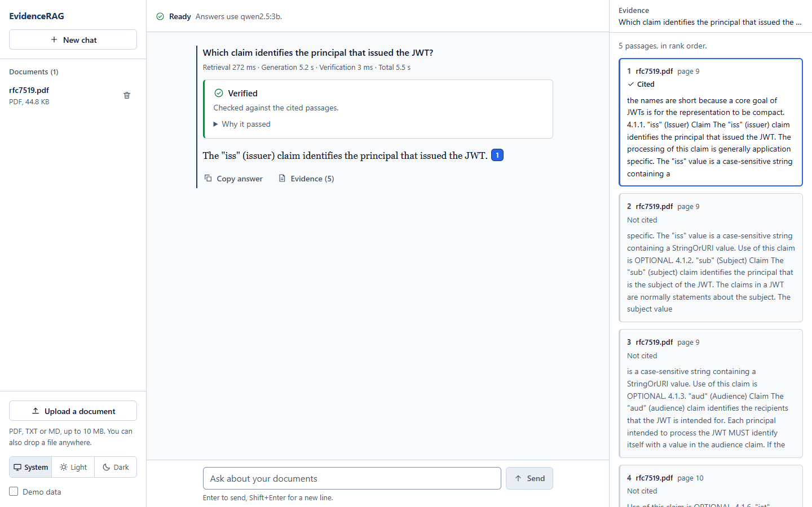
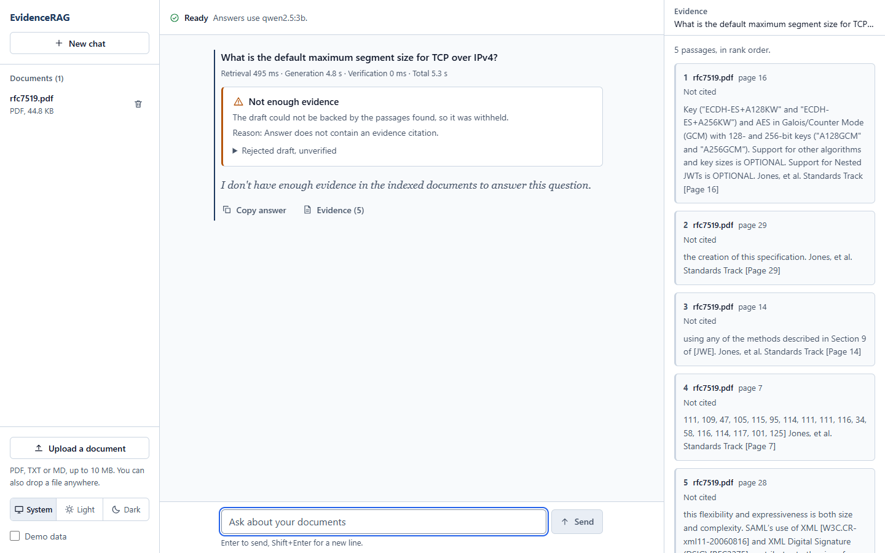
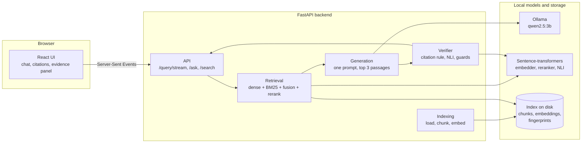
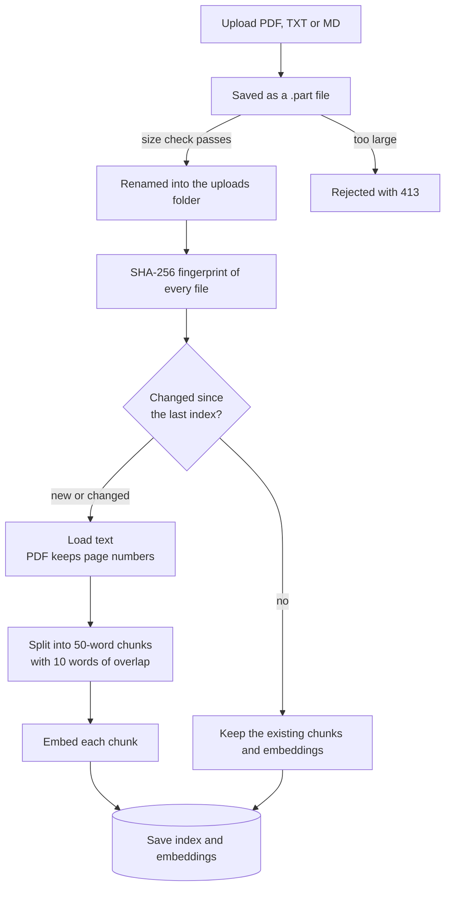
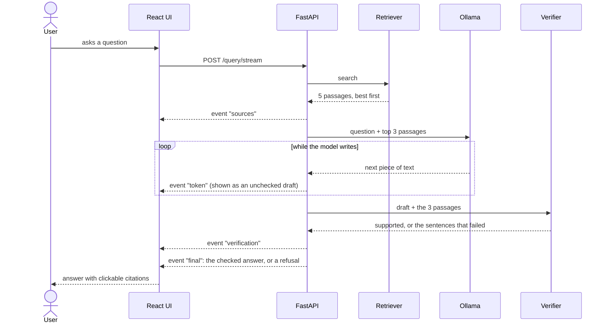
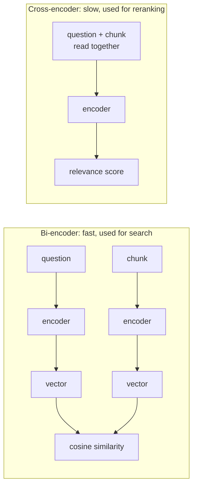
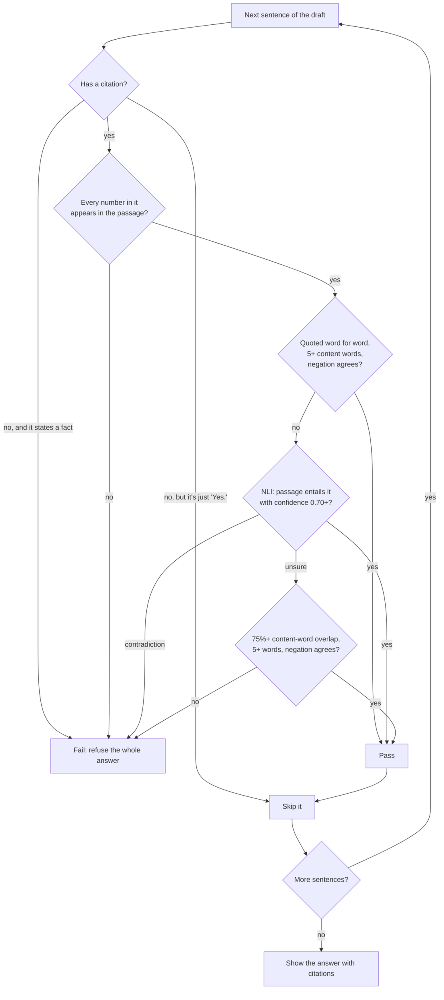
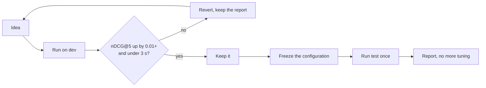

<div align="center">

# EvidenceRAG

### Ask your documents. Get proof, or get told there isn't any.

An educational project on **retrieval-augmented generation (RAG)** that runs entirely on your own machine. It answers questions from your documents, shows the passage behind every sentence, checks each sentence before showing it, and refuses when the evidence isn't there.

[](https://github.com/Sahil-u07/evidencerag/actions/workflows/ci.yml)


[What you'll learn](#what-this-project-teaches) · [Quick start](#quick-start) · [Architecture](#architecture) · [Concepts](#the-concepts-step-by-step) · [Evaluation](#how-it-was-evaluated) · [Results](#results) · [Limits](#what-it-gets-wrong)

</div>

<table>
<tr>
<td width="50%"></td>
<td width="50%"></td>
</tr>
<tr>
<td align="center"><b>The document answers it.</b> Each sentence links to its passage.</td>
<td align="center"><b>The document doesn't.</b> So the app refuses.</td>
</tr>
</table>

<sub>Both screenshots are from a real run with <code>qwen2.5:3b</code> through Ollama and RFC 7519 (JWT) uploaded.</sub>

---

## What this project teaches

| Topic | Where it shows up here |
|---|---|
| How RAG works end to end | [Architecture](#architecture) and the [query walk-through](#one-question-from-start-to-finish) |
| Keyword search vs meaning search | [BM25](#2-bm25-keyword-search) and [dense retrieval](#3-dense-retrieval-meaning-search) |
| Combining two rankings | [Reciprocal rank fusion](#4-reciprocal-rank-fusion) |
| Why a second, slower ranker helps | [Cross-encoder reranking](#5-cross-encoder-reranking) |
| Checking a model's output instead of trusting it | [The verifier](#7-the-verifier) and [NLI](#natural-language-inference-in-one-paragraph) |
| Measuring a search system properly | [Metrics](#the-metrics) and [dev and test splits](#tuning-without-cheating) |
| Reporting uncertainty honestly | [Bootstrap intervals](#bootstrap-confidence-intervals) |
| Why a failed experiment is still a result | [The graveyard](#the-graveyard-what-didnt-work) |

You don't need a GPU or an API key. Everything here runs on a normal laptop CPU.

## Quick start

You need Python 3.12, Node 22.12 or newer, and [Ollama](https://ollama.com/download).

**1. Get the model**

```bash
ollama pull qwen2.5:3b
```

**2. Start the backend**

```bash
cd backend
python -m venv .venv
source .venv/bin/activate          # PowerShell: .\.venv\Scripts\Activate.ps1
pip install -r requirements.txt
uvicorn app.main:app
```

The first start downloads three small Hugging Face models. API docs are at `http://127.0.0.1:8000/docs`.

**3. Start the frontend**

```bash
cd frontend
npm ci
npm run dev
```

Open `http://localhost:5173`, drop in a PDF, TXT or Markdown file, and ask a question.

<details>
<summary><b>Optional settings</b></summary>

<br>

The defaults work without a `.env`. To change them, copy `.env.example` to the repository root as `.env`.

| Variable | Default | Meaning |
|---|---|---|
| `OLLAMA_URL` | `http://127.0.0.1:11434` | Where Ollama listens |
| `OLLAMA_MODEL` | `qwen2.5:3b` | Generation model |
| `MAX_UPLOAD_SIZE_MB` | `10` | Upload size limit |
| `INDEX_STORAGE_DIR` | `data/index` | Index location |
| `UPLOAD_DIR` | `data/uploads` | Upload location |
| `READ_ONLY` | `false` | Public demo mode: sample documents only, uploads and deletes refused |

The API accepts browser requests from port 5173. To point the frontend elsewhere, set `VITE_API_BASE`.

</details>

---

## Architecture



Three small models from Hugging Face do the searching and checking, and one larger model through Ollama writes the answer. Nothing leaves your machine.

| Job | Model | Size and role |
|---|---|---|
| Embeddings | `all-MiniLM-L6-v2` | Turns text into a 384-number vector for meaning search |
| Reranking | `cross-encoder/ms-marco-MiniLM-L-6-v2` | Scores question and passage pairs |
| Checking | `cross-encoder/nli-MiniLM2-L6-H768` | Decides whether a passage supports a sentence |
| Writing | `qwen2.5:3b` through Ollama | Writes the draft answer from three passages |

### Adding a document



Fingerprinting means an unchanged document is never embedded twice. Writing to a `.part` file first means a half-uploaded file can never end up in the index.

### One question, from start to finish



The user sees the draft appear live, but it stays labelled **"Draft, not checked yet"** until the `final` event arrives. Only the final answer can show as verified.

---

## The concepts, step by step

### 1. Chunking

A long document is split into small overlapping pieces, so search can point at the exact part that answers a question.

```text
words:   [ 1 ............................ 50 ]
                                  [ 41 ............................ 90 ]
                                                            [ 81 ...... ]
         |<----- chunk 1 ----->|
                               overlap of 10 words keeps a sentence
                               that crosses a boundary findable
```

This project uses 50-word chunks with 10 words of overlap. PDF chunks keep their page number, so a citation can say "page 9".

### 2. BM25: keyword search

BM25 scores a chunk by how often it contains the question's words, giving rare words more weight than common ones and not over-rewarding long chunks.

$$
\text{BM25}(D, Q) = \sum_{q \in Q} \text{IDF}(q) \cdot \frac{f(q, D)\,(k_1 + 1)}{f(q, D) + k_1 \left(1 - b + b \frac{|D|}{\text{avgdl}}\right)}
$$

- $f(q, D)$ is how often word $q$ appears in chunk $D$.
- $\text{IDF}(q)$ is high for rare words such as `SYN-RECEIVED` and low for words like "the".
- $|D| / \text{avgdl}$ compares the chunk's length with the average length.
- $k_1$ and $b$ control saturation and length normalisation (the library defaults here are 1.5 and 0.75).

**Good at:** exact terms and identifiers. **Weak at:** questions worded differently from the document.

### 3. Dense retrieval: meaning search

An embedding model turns text into a vector, so texts with similar meaning land close together. The question and every chunk become 384-number vectors, and the search ranks chunks by cosine similarity:

$$
\cos(\mathbf{q}, \mathbf{d}) = \frac{\mathbf{q} \cdot \mathbf{d}}{\lVert \mathbf{q} \rVert \, \lVert \mathbf{d} \rVert}
$$

The vectors are normalised to length 1, so this is a single dot product per chunk.

**Good at:** paraphrases and related wording. **Weak at:** rare exact identifiers it never learned.

### 4. Reciprocal rank fusion

BM25 and dense search produce scores on completely different scales, so they can't be added directly. Reciprocal rank fusion (RRF) uses only each chunk's **position** in each list:

$$
\text{RRF}(d) = \sum_{\text{lists } L} \frac{1}{k + \text{rank}_L(d)} \qquad k = 60
$$

```text
            BM25 rank   Dense rank   RRF score
chunk A         1           4        1/61 + 1/64 = 0.0320
chunk B         3           1        1/63 + 1/61 = 0.0323   <- wins
chunk C         2           -        1/62        = 0.0161
```

A chunk that ranks well in both lists beats one that is top in only one. The fused list keeps the best 20 candidates.

### 5. Cross-encoder reranking



A bi-encoder encodes the question and chunk separately, which is fast enough to search thousands of chunks. A cross-encoder reads them together, so it can compare every word of one against every word of the other, which is far more accurate but too slow for the whole index. So the system uses each where it fits: fast search finds 20 candidates, then the cross-encoder reorders those 20.

### 6. Grounded generation

The model gets only the **top 3** reranked passages, at temperature 0 and with up to 80 tokens of output. The prompt tells it to use only those passages and to say it doesn't have enough evidence when they don't answer the question. After it writes, the app attaches `[Evidence N]` to each sentence, using the passage it shares the most words with.

### 7. The verifier

This is the part that makes the project different from a basic RAG demo. Every sentence must pass before the answer is shown, and **one failure throws out the whole draft**.



The number and negation guards exist because a small NLI model can be fooled by near-identical wording. "Requires seven conditions" and "requires four conditions" share almost every word, but one is false.

#### Natural language inference in one paragraph

NLI is a classification task: given a **premise** (the passage) and a **hypothesis** (the sentence), decide whether the premise **entails** it, **contradicts** it, or is **neutral** about it. The verifier treats only confident entailment as support, and treats contradiction as a hard fail that no other rule can override.

---

## How it was evaluated

The project originally reported nDCG@5 of 0.973, on a 20-question test with 33 chunks. That test was too easy to mean much: the best system was already at its ceiling. So a harder benchmark was built:

| Part | What it contains |
|---|---|
| Corpus | Six real RFCs: TCP, JWT, DNS, HTTP semantics, TLS 1.3, OAuth 2.0. Two PDFs, four text files, 4,706 chunks |
| Retrieval questions | 80 questions, split into 40 `dev` and 40 `test`. Each split has 20 paraphrase, 12 identifier and 8 multi-fact questions |
| Labels | Each question carries one or two exact phrases from the documents. A chunk counts as relevant if it contains one |
| Verifier cases | 60 labelled answers, 30 `dev` and 30 `test`, half supported and half not, across nine categories such as negation and wrong numbers |
| Answer runs | The 80 questions through the whole pipeline with real generation |

Labelling by evidence text, not chunk ids, means the labels stay valid when the chunking changes.

### Tuning without cheating



If you tune on the same questions you report, you're measuring how well you memorised them. Here, every change was judged on `dev` only, and `test` was run once at the very end. The script refuses to run `test` without a `--final` flag and records how many times it ran.

### The metrics

| Metric | Question it answers | Formula |
|---|---|---|
| Hit@k | Is anything relevant in the top k? | 1 if yes, 0 if no, averaged over questions |
| Recall@k | How many required facts are in the top k? | facts found / facts needed |
| MRR | How high is the first relevant result? | $\frac{1}{\text{rank of first relevant}}$ |
| nDCG@k | Are relevant results near the top? | $\frac{\text{DCG}@k}{\text{ideal DCG}@k}$, with $\text{DCG}@k = \sum_{i=1}^{k} \frac{\text{rel}_i}{\log_2(i+1)}$ |

nDCG rewards putting relevant chunks higher: a hit at rank 1 counts fully, a hit at rank 5 counts less than half as much.

### Bootstrap confidence intervals

With only 40 questions, a score could easily shift by a few points on a different 40. To show that, each score comes with a 95% interval: resample the 40 questions with replacement 10,000 times, recompute the score each time, and take the middle 95% of the results. **If two systems' intervals overlap a lot, the data can't tell them apart.**

---

## Results

Every number here comes from a JSON report in [`data/evaluation/reports/`](data/evaluation/reports), and you can re-run them.

### Held-out test set

| | Original code | Final |
|---|---:|---:|
| Retrieval nDCG@5 | 0.425 (0.297 to 0.558) | **0.468** (0.338 to 0.599) |
| Verifier accuracy | 0.633 (0.467 to 0.800) | **0.867** (0.733 to 0.967) |
| False claims accepted | 5 of 15 | **2 of 15** |
| True claims refused | 6 of 15 | **2 of 15** |
| Answers verified | not measured | **0.375** (0.225 to 0.525) |
| Answers refused | not measured | **0.625** (0.475 to 0.775) |
| Answers useful | not measured | **0.225** (0.100 to 0.350) |

**How to read this:**
- **Retrieval:** the intervals overlap heavily, so the gain is inconclusive.
- **Verifier:** the clearest improvement, but from only 30 cases, so it's suggestive rather than settled.
- **Answers:** the app refuses most questions. "Useful" means verified with at least half of the labelled evidence's words in the answer, a rough proxy that doesn't check correctness.

<details>
<summary><b>Retrieval in detail</b></summary>

<br>

Reranked Hybrid on test (`shipped-retrieval-test.json`, `final-retrieval-test.json`):

| | Hit@1 | Hit@3 | Hit@5 | MRR | nDCG@5 | Median latency |
|---|---|---|---|---|---|---:|
| Original | 0.350 (0.200 to 0.500) | 0.500 (0.350 to 0.650) | 0.550 (0.400 to 0.700) | 0.438 (0.300 to 0.575) | 0.425 (0.297 to 0.558) | 931 ms |
| Final | 0.350 (0.200 to 0.500) | 0.500 (0.350 to 0.650) | 0.600 (0.450 to 0.750) | 0.449 (0.316 to 0.586) | 0.468 (0.338 to 0.599) | 483 ms |

The two latency figures came from different times on the same laptop, so they aren't a measured speed-up.

All four systems, final code:

| System | Hit@5 | nDCG@5 | Median latency |
|---|---|---|---:|
| Dense | 0.500 (0.350 to 0.650) | 0.406 (0.274 to 0.542) | 12 ms |
| BM25 | 0.475 (0.325 to 0.625) | 0.390 (0.255 to 0.526) | 13 ms |
| Hybrid (RRF) | 0.500 (0.350 to 0.650) | 0.416 (0.275 to 0.558) | 36 ms |
| Reranked Hybrid | 0.600 (0.450 to 0.750) | 0.468 (0.338 to 0.599) | 483 ms |

By question type, Reranked Hybrid, final:

| Type | Questions | Hit@5 | nDCG@5 |
|---|---:|---|---|
| Identifier | 12 | 0.833 (0.583 to 1.000) | 0.662 (0.448 to 0.846) |
| Multi-fact | 8 | 0.875 (0.625 to 1.000) | 0.709 (0.444 to 0.936) |
| Paraphrase | 20 | 0.350 (0.150 to 0.550) | 0.254 (0.100 to 0.426) |

Exact terms are found well. Reworded questions aren't: that's the system's biggest weakness, and it's where most refusals come from.

The original 20-question set stays as a regression check. Reranked Hybrid still scores Recall@1/3/5 of 0.650, 0.975 and 0.975, MRR 1.000 and nDCG@5 0.973, exactly as before (`final-retrieval-v1.json`).

</details>

<details>
<summary><b>Answers in detail</b></summary>

<br>

`qwen2.5:3b`, whole pipeline (`final-answers-dev.json`, `final-answers-test.json`):

| | Dev | Test |
|---|---|---|
| Verified | 0.450 (0.300 to 0.600) | 0.375 (0.225 to 0.525) |
| Refused | 0.550 (0.400 to 0.700) | 0.625 (0.475 to 0.775) |
| Useful | 0.375 (0.225 to 0.525) | 0.225 (0.100 to 0.350) |
| Verified, when the right chunk was in the top 3 | 0.630 (0.444 to 0.815) | 0.550 (0.350 to 0.750) |
| Generation time, median | 4,643 ms | 5,854 ms |

By type on test: identifier 0.583 verified, multi-fact 0.500, paraphrase 0.200.

</details>

### The graveyard: what didn't work

Ideas that looked promising, measured on dev. Almost nothing passed the bar.

| Trial | Dev nDCG@5 | Median | Verdict |
|---|---:|---:|---|
| **Current setup** | **0.621** | 390 ms | Kept |
| BM25 with stopwords and stemming | 0.630 | 459 ms | Out: +0.009, just under the bar |
| BGE embeddings with query prefix | 0.617 | 414 ms | Out |
| 40 reranker candidates | 0.608 | 2,199 ms | Out |
| 10 reranker candidates | 0.598 | 551 ms | Out |
| Bigger L-12 reranker | 0.592 | 799 ms | Out |
| BGE embeddings | 0.574 | 557 ms | Out |
| Sentence chunks, 200 words | 0.572 | 3,076 ms | Out, and too slow |
| Sentence chunks, 120 words | 0.570 | 1,827 ms | Out |

**The biggest gain came from a bug fix, not tuning.** PDF chunk numbering restarted on every page, so chunks on different pages shared an id and fusion merged them. On RFC 9293, 843 chunks had just 16 unique ids, so most of the document was unreachable. Fixing it took dev nDCG@5 from 0.568 to 0.621.

**Choosing the model**, 40 dev questions:

| Model | Verified | Refused | Useful | Median generation |
|---|---:|---:|---:|---:|
| `llama3.2:1b` | 0.275 | 0.725 | 0.200 | 4,736 ms |
| `llama3.2:3b` | 0.325 | 0.675 | 0.275 | 6,418 ms |
| **`qwen2.5:3b`** | **0.450** | **0.550** | **0.375** | 5,766 ms |

**A smarter verifier, reverted.** Checking claims against a focused window of the passage, and choosing citations by entailment, got more answers verified (0.450 to 0.525). But useful answers only rose from 0.375 to 0.400, under the 0.05 bar, and reading the answers by hand showed the window had let two wrong ones through. It was reverted, and its reports are kept.

### Lessons from the results

1. **Check the data before tuning.** A bug that dropped most of each PDF mattered more than any parameter.
2. **An easy benchmark hides problems.** 0.973 on 33 chunks said little. The harder test showed what actually fails.
3. **Strict checking has a price.** The verifier cut false claims from 5 to 2 of 15, but the app now refuses most questions.
4. **Read the outputs, not just the score.** A change that raised the verified rate turned out to verify wrong answers.
5. **Small samples need intervals.** Many differences that look real disappear once you see how wide the intervals are.

---

## What it gets wrong

- **Verified doesn't mean correct.** One dev answer passed saying ES256 MUST be implemented, when the passage says RECOMMENDED.
- **It refuses a lot:** 22 of 40 dev questions and 25 of 40 test questions, mostly reworded ones where retrieval misses the passage.
- **The NLI model is small.** It reads whole 50-word chunks, and refused 4 of 15 supported dev cases.
- **Summary sentences hurt.** An uncited "In summary..." fails the whole answer, even when the rest is sound.
- **The benchmark isn't independently reviewed.** The split was frozen before any results were seen, but nobody outside the project has checked the labels. A few dev and test questions share neighbouring text.
- **Small samples.** 40 test questions gives wide intervals.
- **One laptop.** All timings come from one CPU-only machine. The answer reports ran with Ollama at `localhost`, which added about 2 seconds per request there, so their generation times read about 2 seconds high.
- **Browser tests aren't in the repo.** The UI was checked in Chrome with scripts that aren't committed. CI runs the unit tests, frontend lint and build.

---

## Under the hood

<details>
<summary><b>API</b></summary>

<br>

| Method | Endpoint | Description |
|---|---|---|
| `GET` | `/health` | Readiness, model, whether Ollama is available, read-only mode |
| `POST` | `/search` | Retrieval only, no generation |
| `POST` | `/ask` | Full pipeline, one JSON response |
| `POST` | `/query/stream` | Full pipeline as Server-Sent Events |
| `POST` | `/documents/upload` | Upload a PDF, TXT or MD file |
| `GET` | `/documents` | List uploaded documents |
| `DELETE` | `/documents/{filename}` | Remove a document and rebuild the index |

`/search`, `/ask` and `/query/stream` take `{"query": "...", "top_k": 5}`. `top_k` is 1 to 20, and the query is limited to 500 characters.

Stream events, in order:

| Event | Data |
|---|---|
| `stage` | `{"i": 1, "ms": ...}` after retrieval, 2 after generation, 3 after verification |
| `sources` | `{"items": [...]}`, the passages |
| `token` | `{"t": "..."}`, a piece of the unchecked draft |
| `verification` | `supported`, `cited_evidence`, `unsupported_claims`, `reason` |
| `final` | `{"answer": "...", "supported": bool, "latency_ms": ...}`, the answer to show |
| `done` | `{"latency_ms": ..., "supported": bool}` |
| `error` | `{"message": "..."}`, sent instead of the events that would follow |

</details>

<details>
<summary><b>The stack</b></summary>

<br>

| Layer | Using |
|---|---|
| Frontend | React 19, TypeScript, Vite, plain CSS, Server-Sent Events |
| Backend | Python 3.12, FastAPI, Pydantic |
| Retrieval | sentence-transformers, `rank_bm25`, NumPy |
| Generation | Ollama with `qwen2.5:3b` |
| Verification | NLI cross-encoder plus rule-based guards |
| Storage | NumPy embedding matrix, JSON metadata, SHA-256 fingerprints |
| Testing | pytest, Node's test runner, ESLint, GitHub Actions |

</details>

<details>
<summary><b>Run the tests and benchmarks</b></summary>

<br>

```bash
cd backend && python -m pytest -q
```

```bash
cd frontend && npm test && npm run lint && npm run build
```

Benchmarks, from `backend/` with the virtual environment active:

```bash
python -m scripts.benchmark retrieval --set dev --label mine
python -m scripts.benchmark verification --set dev --label mine
python -m scripts.benchmark answers --set dev --label mine      # needs Ollama
```

Reports go to `data/evaluation/reports/<label>-<kind>-<set>.json`. The test split needs `--final` and should be run once. Use a new `--label`, because `final` would overwrite the published reports. The full benchmark design is in [`docs/benchmark-design.md`](docs/benchmark-design.md).

</details>

<details>
<summary><b>Public demo and deployment</b></summary>

<br>

`deploy/hf-space/` builds one Docker image with the backend, the built frontend, Ollama and `qwen2.5:3b`, with six sample RFCs indexed at build time. It runs in `READ_ONLY` mode: uploads and deletes are refused, so visitors can't see or remove each other's files, and only one answer runs at a time.

A static build with `VITE_DEMO_ONLY=true` runs the frontend on made-up demo data, with a banner saying so. It never shows a verified answer.

</details>

<details>
<summary><b>Repository layout</b></summary>

<br>

```text
evidencerag/
├── backend/
│   ├── app/
│   │   ├── core/          # settings, retrieval defaults, sentence splitting
│   │   ├── evaluation/    # metrics, evidence labels, bootstrap intervals
│   │   ├── generation/    # prompt, Ollama client, streaming, pipeline, verifier
│   │   ├── ingestion/     # loading and chunking
│   │   ├── reranking/     # cross-encoder and the reranked hybrid retriever
│   │   ├── retrieval/     # dense, BM25, fusion, persistent store
│   │   ├── indexing.py    # incremental index build
│   │   ├── main.py        # FastAPI app
│   │   └── schemas.py
│   ├── scripts/benchmark.py
│   └── tests/
├── frontend/src/          # React and TypeScript: components, hooks, lib
├── data/evaluation/
│   ├── corpus/            # the original 20-question set's 4 files
│   ├── v2/                # six RFCs, questions, verifier cases, SOURCES.md
│   └── reports/           # every benchmark report cited in this README
├── deploy/hf-space/       # Docker image for a public read-only demo
├── docs/benchmark-design.md
└── .github/workflows/ci.yml
```

</details>

## Further reading

- Robertson and Zaragoza, *The Probabilistic Relevance Framework: BM25 and Beyond* (2009), on BM25.
- Cormack, Clarke and Büttcher, *Reciprocal Rank Fusion Outperforms Condorcet and Individual Rank Learning Methods* (SIGIR 2009), on RRF.
- Reimers and Gurevych, *Sentence-BERT* (EMNLP 2019), on sentence embeddings.
- Nogueira and Cho, *Passage Re-ranking with BERT* (2019), on cross-encoder reranking.
- Lewis et al., *Retrieval-Augmented Generation for Knowledge-Intensive NLP Tasks* (NeurIPS 2020), the paper that named RAG.

## License

The code is [MIT](LICENSE). `qwen2.5:3b` is under the Qwen Research License, so check its terms for your use. The RFC texts are redistributed under the IETF Trust's provisions ([`SOURCES.md`](data/evaluation/v2/corpus/SOURCES.md)).

<div align="center">

Built by [Sahil](https://github.com/Sahil-u07) as an educational project.

</div>
